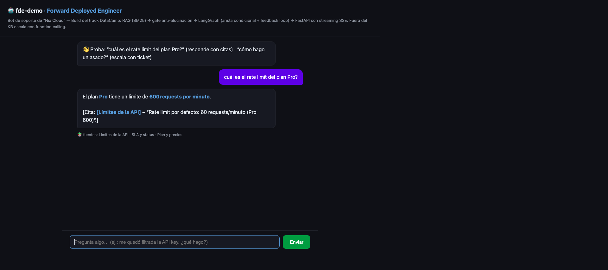
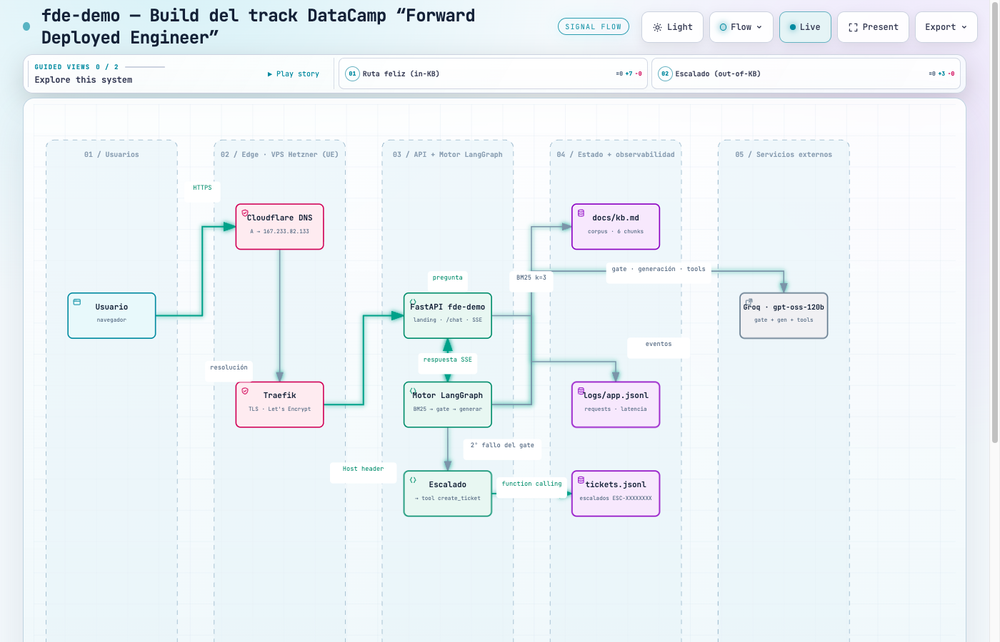

# fde-demo — Bot de soporte Forward Deployed Engineer 🤖

[](https://app.datacamp.com/learn/career-tracks/forward-deployed-engineer)


**Build de cierre del career track [Forward Deployed Engineer](https://app.datacamp.com/learn/career-tracks/forward-deployed-engineer) (DataCamp, 17 cursos).** Un bot de soporte para una empresa ficticia ("Nix Cloud") que ejercita el stack completo del track: **RAG → gate anti-alucinación → LangGraph con aristas condicionales → FastAPI con streaming** — corriendo en producción.

🌐 **Demo en vivo:** [fde.analizodatos.com](https://fde.analizodatos.com) · **Diagrama interactivo:** [diagrama archify](https://manuel-arguelles-ai.github.io/fde-demo/)

---

## Qué hace

Un usuario pregunta en el chat; el sistema recupera contexto de una base de conocimiento, un **gate LLM** verifica que el contexto alcanza, y solo entonces responde — **citando la sección** del documento usada. Si el contexto no alcanza dos veces, escala: un **function calling real** crea un ticket de ingeniería con los argumentos que el propio LLM decide.

```
pregunta ──► Retriever BM25 (k=3) ──► Gate LLM ¿contexto alcanza?
                                          │
                     ┌── sí ──────────────┤
                     ▼                    │ NO (1º intento)
              Generador con citas         ▼
                     │              Reformular + re-retrieve
                     ▼                    │ (feedback loop ×1)
              SSE token a token           │ NO (2º intento)
                                          ▼
                                   Escalado → tool create_ticket
                                            └──► tickets.jsonl
```

| Componente | Qué es |
|---|---|
| `app.py` | FastAPI (`/chat` JSON + `/chat/stream` SSE) que compila el `StateGraph` de LangGraph |
| Retriever | **BM25 two-stage** implementado a mano sobre `docs/kb.md` (decisión documentada: sin embeddings para no sumar un proveedor; el swap a un `VectorStoreRetriever` es drop-in) |
| Gate | LLM-as-judge (temp 0) — **arista condicional** + **feedback loop** de LangGraph |
| Escalado | `@tool create_ticket` con `bind_tools`: el LLM decide los argumentos del ticket |
| LLM | Groq · `openai/gpt-oss-120b` (interfaz OpenAI-compatible) |
| Eval | `eval.py` con dataset de 9 casos: **correctness 9/9 · groundedness 6/6** |
| Deploy | Dockerfile · Traefik + Let's Encrypt en VPS (Hetzner) |

## Vista del chat



## Diagrama

Interactivo (con animación de flujo y 2 vistas guiadas): **[abrir el diagrama](https://manuel-arguelles-ai.github.io/fde-demo/)** — generado con [Archify](https://github.com/tt-a1i/archify) (`docs/diagrama.spec.json`).



## Cómo correrlo

```bash
python -m venv .venv && source .venv/bin/activate
pip install -r requirements.txt
export GROQ_API_KEY=...
python app.py                    # http://127.0.0.1:8899
python eval.py                   # eval set (correctness + groundedness)
# o con Docker:
docker build -t fde-demo . && docker run -p 8899:8899 -e GROQ_API_KEY=... fde-demo
```

> Con `FDE_API_KEY` seteada, los endpoints `/chat*` exigen el header `X-API-Key`.

## Cursos del track aplicados aquí

| Curso del track | Dónde vive en el código |
|---|---|
| 1-2. OpenAI API + Prompt Engineering | `ChatGroq` (interfaz OpenAI-compatible) · system prompt con reglas de citación |
| 3. AI Safety and Ethics | Gate anti-alucinación: sin contexto no hay respuesta |
| 4. Software Engineering Principles | Type hints, módulos, docstrings |
| 6. LLMOps Concepts | `/health`, logs JSONL, decisiones trazables |
| 7. LLM Application Fundamentals | App end-to-end: retrieval → validación → generación → API |
| 8. LLM Application Evaluation (LangSmith) | `eval.py` + `eval_set.json` (correctness / groundedness) |
| 9. RAG with LangChain | Chunking por secciones + BM25 two-stage |
| 10. LLM Tool Use | `create_ticket` con `bind_tools` — args decididos por el LLM |
| 11. Agentic Systems with LangGraph | `StateGraph` con arista condicional + feedback loop |
| 13-14. Git | Historia en commits de este repo |
| 15-16. FastAPI + Deploying AI to Production | SSE streaming, middleware de auth, logging, Docker |
| 17. Communicating Data Insights | Este README y el diagrama 🙃 |

*Declarados por diseño (fuera del alcance del demo): MCP (curso 12) y checkpoints/human-in-the-loop (11 avanzado).*

## Evaluación

```
Correctness: 9/9 (100%) — in-KB responde, out-of-KB escala
Groundedness: 6/6 (100%) — cada respuesta cita la sección esperada
```

Preguntas como *"¿cómo hago un asado a la cruz?"* no generan alucinaciones: el gate las rechaza dos veces y el sistema crea un ticket `ESC-XXXXXXXX` persistido en `tickets.jsonl`.

---

*Proyecto de cierre del pipeline pf (Blitz → Brief → Build → Skill) · 15-nov-2026.*
